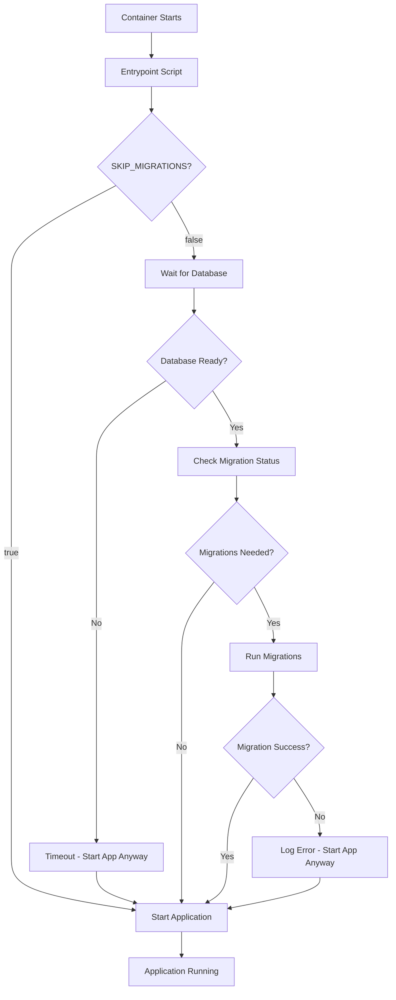

# Integrated Database Migrations

This document explains the new integrated migration system that runs database migrations directly within application containers, only when needed.

## Overview

The migration system has been redesigned to:
- ✅ **Eliminate separate migration containers** - migrations run directly in app containers
- ✅ **Smart conditional execution** - migrations only run when actually needed
- ✅ **Fail-safe startup** - applications start even if migration checks fail
- ✅ **Environment-based control** - migrations can be disabled via environment variables
- ✅ **Database connection waiting** - automatically waits for database availability
- ✅ **Zero-downtime deployments** - multiple instances can start safely

## How It Works

### 1. Container Startup Flow



### 2. Migration Detection Logic

The system uses Prisma's `migrate status` command to determine if migrations are needed:

- **"Database schema is up to date"** → No migrations needed
- **"following migration...have not yet been applied"** → Migrations needed
- **Error or unknown status** → Attempt migrations (safe default)

### 3. Files Structure

```
project-root/
├── scripts/
│   ├── docker-entrypoint.sh      # Main entrypoint script for containers
│   └── check-migrations.sh       # Standalone migration checker
├── apps/
│   ├── core/
│   │   ├── Dockerfile            # Production Dockerfile with migration support
│   │   └── Dockerfile.dev        # Development Dockerfile with migration support
│   └── import/
│       ├── Dockerfile            # Production Dockerfile with migration support
│       └── Dockerfile.dev        # Development Dockerfile with migration support
└── docker-compose.yml            # Updated without separate migration service
```

## Environment Variables

### Migration Control

| Variable | Default | Description |
|----------|---------|-------------|
| `SKIP_MIGRATIONS` | `false` | Set to `true` to completely skip migration checks |
| `DATABASE_URL` | - | Required for migrations to run |

### Usage Examples

```bash
# Normal operation (migrations enabled)
docker run gedu/core:latest

# Skip migrations entirely
docker run -e SKIP_MIGRATIONS=true gedu/core:latest

# With custom database URL
docker run -e DATABASE_URL=postgresql://user:pass@db:5432/mydb gedu/core:latest
```

## Docker Compose Configuration

The updated `docker-compose.yml` removes the separate migration service:

```yaml
services:
  core:
    image: gedu/core:dev
    ports:
      - "3000:3000"
    environment:
      - DATABASE_URL=${DATABASE_URL}
      - SKIP_MIGRATIONS=${SKIP_MIGRATIONS:-false}  # Optional migration control
    # No more depends_on migrate service!
    
  import:
    image: gedu/import:dev  
    ports:
      - "4000:3000"
    environment:
      - DATABASE_URL=${DATABASE_URL}
      - SKIP_MIGRATIONS=${SKIP_MIGRATIONS:-false}  # Optional migration control
```

## Benefits

### 1. **Simplified Deployment**
- No need to manage separate migration containers
- Reduced complexity in orchestration
- Fewer moving parts to debug

### 2. **Improved Reliability**
- Applications start even if migrations fail
- Better handling of database connectivity issues
- Graceful degradation when database is not ready

### 3. **Performance**
- Faster startup when no migrations are needed
- Parallel service startup (no sequential dependencies)
- Reduced resource usage

### 4. **Scalability**
- Multiple instances can start simultaneously
- No single point of failure for migrations
- Better suited for horizontal scaling

## Migration Scripts

### `docker-entrypoint.sh`

The main entrypoint script that:
- Checks if migrations should run
- Waits for database availability
- Runs migrations conditionally
- Starts the application

### `check-migrations.sh`

A standalone script for manual migration checking:

```bash
# Check and run migrations manually
./scripts/check-migrations.sh

# Use in CI/CD pipelines
if ./scripts/check-migrations.sh; then
  echo "Migrations completed or not needed"
else
  echo "Migration check failed"
fi
```

## Troubleshooting

### Common Issues

1. **"Database connection failed"**
   - Ensure `DATABASE_URL` is correct
   - Check if database service is running
   - Verify network connectivity

2. **"Prisma schema not found"**
   - Ensure Prisma files are copied to container
   - Check file paths in Dockerfile

3. **"Migration failed but app started"**
   - This is expected behavior (fail-safe)
   - Check application logs for migration errors
   - Run migrations manually if needed

### Debug Mode

Enable verbose logging by setting environment variables:

```bash
# Enable debug output
docker run -e DEBUG=true gedu/core:latest
```

### Manual Migration

If automatic migrations fail, you can run them manually:

```bash
# Connect to running container
docker exec -it <container-id> /bin/bash

# Run migrations manually
npx prisma migrate deploy --schema=./libs/prisma/prisma/schema.prisma
```

## Migration Best Practices

### 1. **Testing**
- Always test migrations in development first
- Use staging environment that mirrors production
- Test both fresh deployments and updates

### 2. **Monitoring**
- Monitor application startup logs
- Set up alerts for migration failures
- Track migration execution time

### 3. **Rollback Strategy**
- Keep database backups before major migrations
- Test rollback procedures
- Have a plan for failed migrations

### 4. **Performance**
- Review migration performance impact
- Consider running heavy migrations separately
- Use database maintenance windows for major changes

## Comparison: Before vs After

### Before (Separate Migration Container)

```yaml
services:
  migrate:
    image: gedu/migrate:latest
    # Runs first, blocks other services
    
  core:
    depends_on:
      migrate:
        condition: service_completed_successfully
    # Waits for migration to complete
```

**Issues:**
- Sequential startup (slower)
- Single point of failure
- Complex orchestration
- Additional container to manage

### After (Integrated Migrations)

```yaml
services:
  core:
    image: gedu/core:dev
    environment:
      - SKIP_MIGRATIONS=${SKIP_MIGRATIONS:-false}
    # Handles migrations internally
```

**Benefits:**
- Parallel startup (faster)
- Self-contained services
- Simplified orchestration
- Fewer containers to manage

## Conclusion

The integrated migration system provides a more robust, scalable, and maintainable approach to database migrations in containerized environments. It reduces complexity while improving reliability and performance.

For questions or issues, refer to the troubleshooting section or check the application logs for detailed error messages.